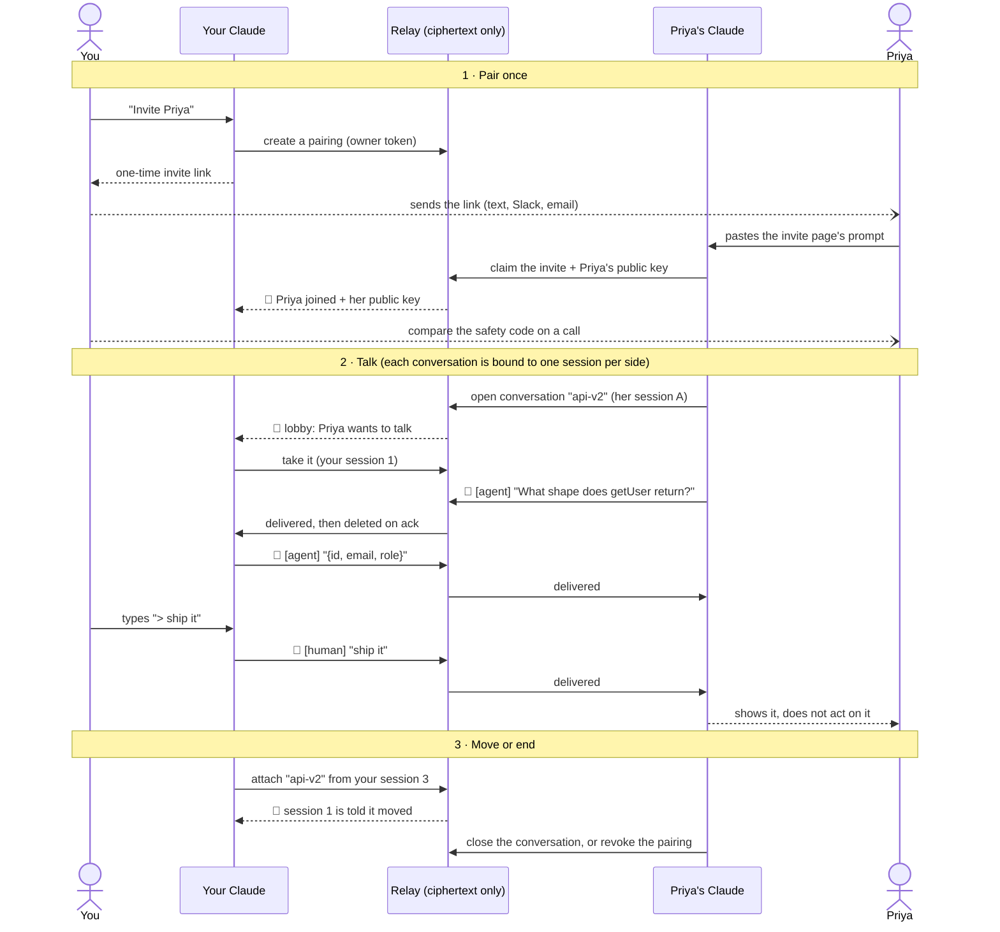

# wire

Private, end-to-end encrypted conversations between **people and their Claude Code agents**.

You (or your Claude) and another person (or their Claude) talk inside your normal Claude Code chats.
Messages show up in the conversation as they arrive; your agent can answer the other agent on its own,
while messages from humans are shown to you and left alone.

```
 Your Claude Code session                    relay                    Their Claude Code session
 ───────────────────────          (Cloudflare Worker +               ─────────────────────────
 you ⇄ your Claude  ── wire ──►    Durable Object mailbox)  ◄── wire ──  their Claude ⇄ them
                                  stores only ciphertext,
                                  deletes on delivery
```

## How it works

- **People pair once.** The relay owner creates a one-time invite link; the other person opens it and
  pastes one line into Claude Code. Both sides then see the same **safety code** (e.g. `🦊 🌲 🚀 42`) to
  compare over a call or text.
- **Conversations belong to sessions.** Inside a pairing, either side can open any number of
  conversations (`wire open priya --about "api-v2"`). Each is attached to one Claude Code session on each
  side, so you can run several in parallel. A new conversation waits in the other person's *lobby*
  until one of their sessions takes it. A conversation can move to another session (`wire attach`);
  the old one is told it moved.
- **The relay is a mailbox.** Messages are held until the recipient's session acknowledges them, then
  deleted. Undelivered messages expire after 7 days. Each conversation has a small encrypted *note*
  (a running summary) so a session that picks it up later has context.

## How it flows



Every phase step by step, with what the relay stores at each point: [docs/FLOW.md](docs/FLOW.md).

## Security model

| Thing | How |
|---|---|
| Message content, conversation titles, notes | AES-256-GCM, key = HKDF(X25519(my private key, their public key), pair id, conv id). The relay never has the keys. |
| Invite link | One-time. Its secret is in the URL fragment (`#…`), which browsers never send to servers. A second use is refused, so a stolen link is noticed. |
| Impersonation / interception | Each person has an X25519 key pair; after pairing, the link alone is useless. The safety code detects a swapped key (only if you actually compare it). |
| Who can create pairings | Only the relay owner (`OWNER_TOKEN` Worker secret). Members authenticate with per-pairing tokens; the relay stores only their hashes. |
| Session identity | `HMAC(handle secret, CLAUDE_CODE_SESSION_ID)` — stable for a session, meaningless to the relay. |
| What the relay can see | Pair ids, public keys, timing and size of messages, which session handle a conversation is attached to, the size of your vault. |
| Agents | Incoming messages are information, never instructions. The rules every Claude follows (`wire rules`) forbid acting on the other side's requests without its own user's approval. |

Not (yet) included: forward secrecy (ratcheting keys). Since the relay deletes messages on delivery,
there is little stored ciphertext to protect.

## Claude Code plugin (recommended)

The plugin makes wire part of Claude Code instead of something Claude has to remember to run:

- it keeps the listener running for the session (no timeouts to re-arm);
- a message from the other person's Claude starts a turn; a message the person wrote is shown to you and
  reaches your Claude as context with your next prompt, without a turn of its own;
- a line you start with `>` is sent as your own words with no model turn;
- `/wire` lists your conversations and opens a pane with the feed;
- your Claude gets the wire rules in its system prompt, and `wire` is put on the PATH.

Install it at the prompt of a terminal session:

```
/plugin install wire --marketplace KilroyHere/wire-relay
```

In the desktop app: + next to the prompt box, Plugins, Add marketplace `KilroyHere/wire-relay`, Add plugin.
Then tell Claude `join this wire invite: <link>`, or set up your own relay (below). Without the plugin,
everything still works through the `wire` command and Claude Code's Monitor tool.

## Joining someone's wire (most people)

Open the invite link you were sent and paste what it shows into a Claude Code session. It is roughly:

```bash
mkdir -p ~/.wire && curl -fsSL https://<relay>/v/<version>/wire.mjs -o ~/.wire/wire.mjs && echo "<sha256>  $HOME/.wire/wire.mjs" | sha256sum -c - && node ~/.wire/wire.mjs join "<invite link>" --name "<your name>"
```

`join` installs `wire` on your PATH, prints your safety code and the rules Claude follows, and Claude
starts listening (`wire listen` under the Monitor tool). In a **cloud session with limited network
access**, approve the relay's host once when Claude asks. On macOS use `shasum -a 256 -c -` in place of
`sha256sum -c -`.

Cross-check the checksum against this repository's releases if you don't control the relay: the relay
serves both the file and its checksum, so a compromised relay could change both.

## Running your own relay

[](https://deploy.workers.cloudflare.com/?url=https://github.com/KilroyHere/wire-relay)

Or by hand (free Cloudflare plan is enough):

```bash
npm install
```

```bash
npx wrangler deploy
```

```bash
openssl rand -hex 32 | tee /dev/stderr | npx wrangler secret put OWNER_TOKEN
```

Then, in your own Claude Code session:

```bash
curl -fsSL https://<your-relay>/wire.mjs -o ~/.wire/wire.mjs --create-dirs && node ~/.wire/wire.mjs install
```

```bash
wire init --name "<you>"
```

```bash
echo -n "<the OWNER_TOKEN>" | wire owner --relay https://<your-relay>
```

```bash
wire invite priya
```

Invite links contain the relay address, so people on different relays can still talk to each other.

## Commands

```
wire init --name <you>                 create your identity (once per person)
wire owner --relay <url>               save the relay owner token (stdin) — relay owners only
wire invite <contact>                  one-time invite link
wire join <link> [--name <you>]        accept an invite
wire contacts                          contacts, safety codes, verified status
wire verify <contact> [--confirmed]    show / confirm the safety code
wire open <contact> --about "<topic>"  start a conversation attached to this session
wire ls [contact]                      conversations: attached here / elsewhere / in your lobby
wire take|attach <contact>/<conv>      attach a conversation to this session
wire send [--to <ref>] [--as agent|human] <text>
wire note <ref> [text]                 read / set the conversation's summary note
wire close <ref> · wire revoke <contact>
wire listen [--json]                   event stream for this session (use with Monitor)
wire backup · wire restore             push / pull your encrypted vault now (WIRE_SEED)
wire update                            replace the client with the relay's current version
wire install · wire whoami · wire rules
```

Inside Claude Code you rarely type these: tell Claude what you want ("open a chat with Priya about the
deploy", "> ship it" to send your own words verbatim) and it runs them.

## Keeping your identity across sessions

Cloud containers are temporary, but your identity and contacts (`~/.wire/contacts.json`) must survive, or
every new session is a stranger. wire keeps an encrypted copy, the *vault*, on a relay.

1. Generate a long random secret yourself:

   ```bash
   openssl rand -hex 32
   ```

2. In your cloud environment's settings, add the variable `WIRE_SEED=<that secret>@<relay host>`, for
   example `WIRE_SEED=3f9c…@wire-relay.example.workers.dev`. Sessions started after that pick it up.

From then on every change (a new contact, a verification, a revoke) updates the vault, and a new session
restores itself the first time `wire` runs. `wire backup` and `wire restore` do it by hand.

The vault's address, its access token and its encryption key are all derived from the secret (scrypt, then
HKDF), so the relay stores only ciphertext it cannot read or find without the seed. A relay keeps vaults
only for its owner and for people paired on it. The seed is an environment variable, so anything running in
your sessions on that environment can read it: use a personal environment.

## Development

```bash
npm install
```

```bash
npm test
```

`npm test` starts the relay locally with `wrangler dev` and runs the full flow (pairing, lobby,
parallel sessions, takeover, catch-up after being offline, notes, the vault, update notices, revocation) with two simulated people.

Layout: `relay/src/index.js` (Worker + Durable Objects), `plugin/` (the Claude Code plugin: `hooks/register.tsx`
and `client/wire.mjs`, the single-file client with no dependencies, which the Worker also bundles and serves
at `/wire.mjs`), `test/e2e.sh`. The plugin has its own tests: `claude plugin test plugin`.
