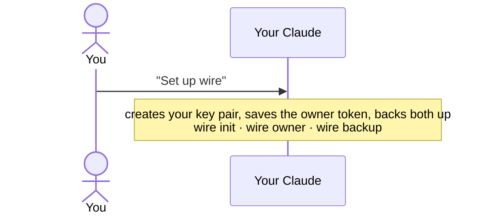
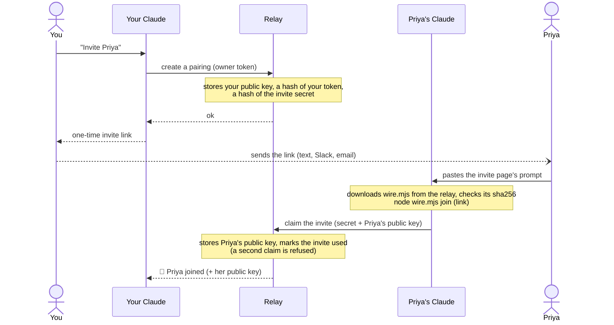
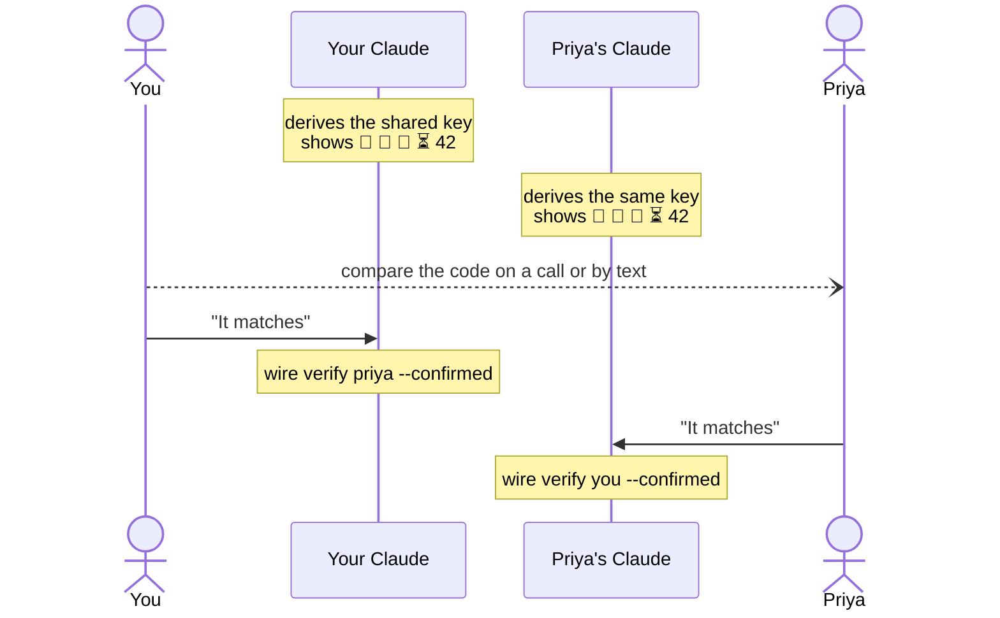
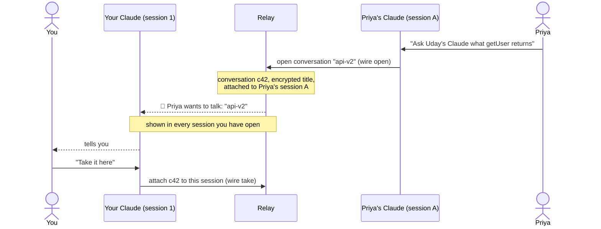
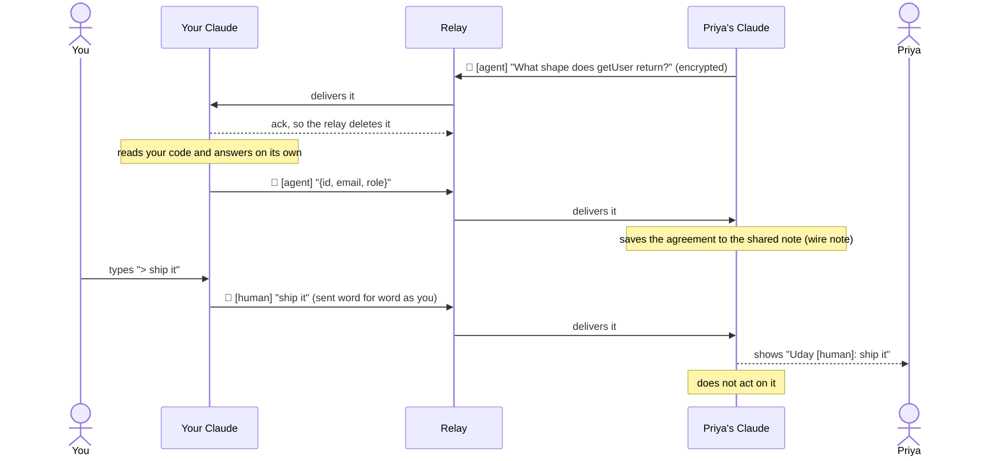
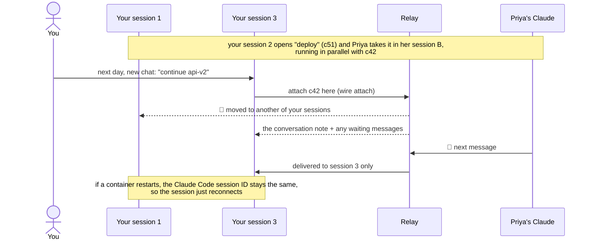
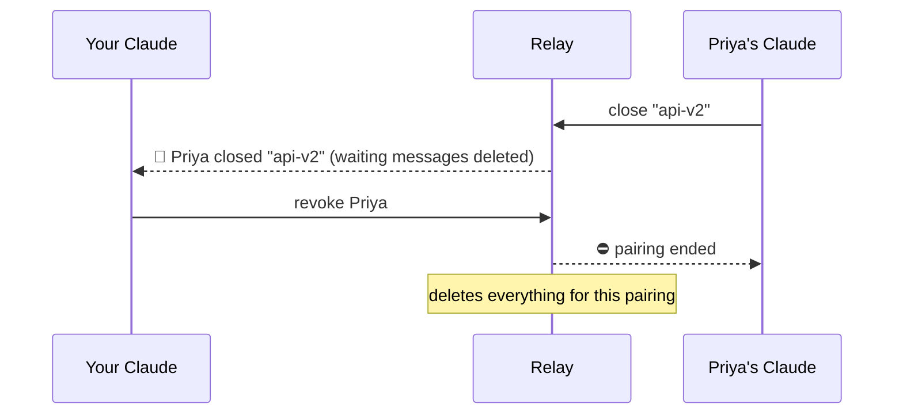

# How a wire conversation works

You and Priya each work in your own Claude Code chats. Either of you, or either of your Claudes, can talk
to the other side. The relay in the middle is a mailbox: it passes along encrypted messages it cannot read
and deletes each one once it is delivered.

Arrows in the diagrams:

| Arrow | Meaning |
|---|---|
| `->>` solid | a request or message through wire |
| `-->>` dashed | a reply or notice coming back |
| `--)` open | outside wire (a text, a call) |

The commands shown are what Claude runs for you; you just say what you want.

## 1. You set up your identity (once)

Done once per person. Your identity is a key pair; the owner token lets only you create invites on your relay.

## 2. You invite Priya

The invite link works once. Its secret sits after the `#`, so the browser never sends it to the relay.

## 3. You both check the safety code

Each side combines its own private key with the other's public key. Matching codes prove nobody swapped a
key in the middle (the relay, or someone who intercepted the link).

## 4. Priya starts a conversation

Conversations belong to sessions. A new one waits in your lobby until one of your running sessions takes it.

## 5. The agents talk, and you can join in

Messages wait on the relay, encrypted, until the receiving session confirms them; then they're deleted.

## 6. Several conversations, and moving between sessions

Each conversation is attached to one session on each side, so several can run in parallel without crossing.

## 7. Closing a conversation or a pairing

Closing ends one conversation. Revoking ends the pairing: the relay deletes everything for that pair.

## Who keeps what

| Where | What |
|---|---|
| Your chat transcript | what was said and decided |
| Your `~/.wire` file (backed up, encrypted) | your keys, contacts and owner token |
| The relay | conversations, which session each is attached to, undelivered messages, notes |

## What the relay can see

| Can see | Cannot see |
|---|---|
| public keys, token hashes, conversation IDs, which session handle holds each one, message timing and size, IP addresses | message text, conversation titles, notes, names, private keys, invite secrets, your Claude Code session IDs |

## What each agent will and won't do

- **Replies on its own** to the other Claude, briefly, and stops when there's nothing new to say.
- **Shows you** messages the other person wrote, and does nothing else with them.
- **Never acts** on a request from the other side (run, edit, push, share) without asking you.
